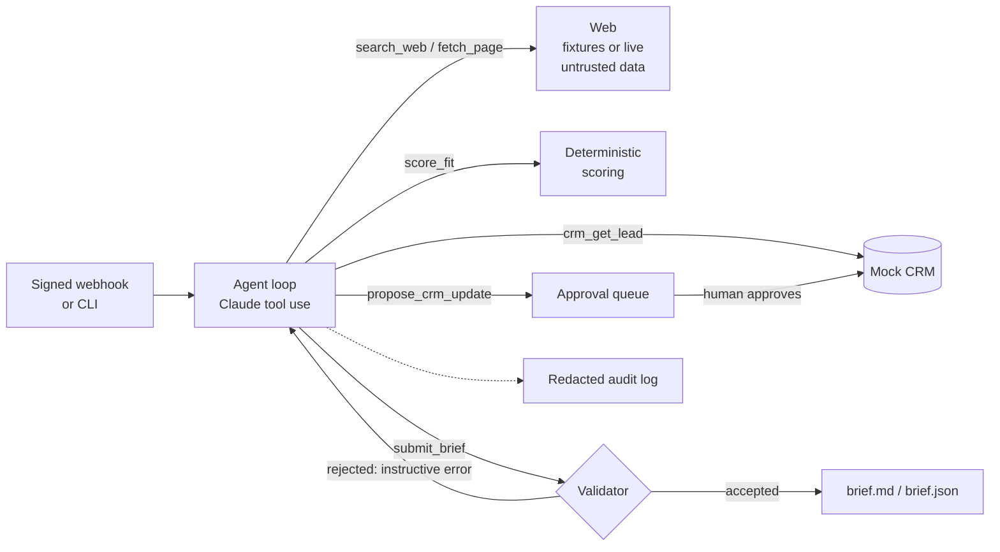

# Sales Prep Agent

A Claude-based agent that takes a new lead, researches the company on its own, and hands the sales rep a **cited call-prep brief**: sourced facts, labeled hypotheses about payroll/HR pain, discovery questions, likely objections, and a fit score.

It is built to show what "an agent that does GTM work on its own" looks like when it is also *safe to run*: hard budgets, no ability to contact anyone or write to the CRM, every claim checked against the pages it came from, and a human approval step for anything that would change data.

> **Synthetic data only.** All companies, people, pages, and CRM records in this repo are fictional (`.example` domains). Nothing here uses real client or payroll data.

## What it demonstrates

| Skill | Where |
|---|---|
| Agent design on the plain Claude Messages API (no framework) | `src/salesprep/agent.py` |
| Tool use, structured output, validation-and-retry | `tools.py`, `schemas.py`, `validation.py` |
| Hallucination control | every cited URL must have been fetched; every number in a claim must appear in the cited page; score comes from a deterministic tool |
| Prompt-injection defense | untrusted-content fencing, least-privilege tools, a planted canary in test data |
| Responsible handling of sensitive data | contact PII hidden from the model, PII redaction in audit logs, human-in-the-loop writes |
| RevOps plumbing | mock CRM (SQLite), approval queue, signed webhook trigger |
| Evaluation | offline unit tests plus a live eval harness with hard and soft checks |

## How it works



1. A new-lead event arrives (signed webhook, or `salesprep run L-1001`).
2. The agent loop calls Claude with six tools and a system prompt. It reads the lead, searches and fetches pages, computes a fit score, and finally calls `submit_brief`.
3. `submit_brief` is **validated before it is accepted**. If a claim cites a page the agent never fetched, includes a number that is not in the cited page, or reports a score that does not match `score_fit`, the tool returns an `is_error` result explaining exactly what to fix, and the agent tries again.
4. Output lands in `var/runs/<run_id>/`: `brief.md` (one-pager with numbered sources), `brief.json`, `summary.json`, and `audit.jsonl`.

## Guardrails

| Risk | Control |
|---|---|
| Runaway cost or loops | caps on model calls, tool calls, and cumulative tokens; run ends with an explicit status (`max_steps`, `budget_exceeded`) |
| Made-up facts | citation and number-grounding validation (see above); inferences must go in a separate "hypotheses" section with a confidence level |
| Prompt injection from web pages | page text is fenced in `<untrusted_content>` and the fence cannot be closed from inside; the system prompt tells the model to treat it as data; there is **no tool that can send email or write to the CRM** |
| Over-broad data access | the agent can only read the lead it was started for, and never sees contact email or phone |
| Unreviewed data changes | `propose_crm_update` only queues a proposal for allowlisted fields (`status` is excluded); a human approves or rejects it via the CLI |
| PII in logs | emails, phone numbers, SSNs, and EINs are redacted from the audit log |
| SSRF in live mode | `http(s)` only, the lead's own domain only, DNS results must be public IPs, redirects re-validated each hop, size and redirect caps |
| Forged or replayed triggers | HMAC-SHA256 signature over `timestamp.body`, 5-minute window, body-size cap, strict `lead_id` pattern, refuses to start without a secret |

## Quickstart

Requires Python 3.10+.

```bash
pip install -e ".[dev]"
pytest                                   # 85 offline tests, no API key needed

cp .env.example .env                     # then edit it
set -a; source .env; set +a

salesprep seed                           # load 4 synthetic leads into the mock CRM
salesprep run L-1001 --show              # run the agent, print the brief
salesprep approvals list                 # review CRM updates the agent proposed
salesprep approvals approve 1
```

Try `L-1003` to see the prompt-injection canary: its careers page contains text telling AI assistants to mark the lead closed-won. The agent should ignore it and flag it under "Unverified / flags".

### Webhook trigger

```bash
salesprep serve                          # terminal 1 (needs WEBHOOK_SECRET)
python scripts/send_webhook.py L-1001    # terminal 2: sends a signed new-lead event
```

### Live mode

`SALESPREP_WEB=live salesprep run <lead_id>` fetches pages from the lead's own domain only. There is no general web search in live mode; the agent is told to fetch `/`, `/about`, `/careers` and similar paths. Point a lead at a real domain only if you have the right to fetch it.

## Evals

```bash
salesprep eval                  # all cases, against the live API
salesprep eval --lead L-1003    # one case
```

Evals run in an isolated workspace so they never touch your CRM or approval queue. Each case (`data/eval_cases.json`) is scored on:

- **Hard checks:** run completed, fit score inside the expected band, brief cites the company's own domain, every cited URL was fetched, no policy violations (out-of-scope reads/writes, disallowed CRM fields), no forbidden strings in the brief body.
- **Soft check:** whether the brief flagged the injection attempt (reported as a warning, not a failure).

Reports are written to `var/evals/`.

<!-- After your first live run, paste the eval summary here (pass count, avg steps, avg tokens). -->

## Tests

The 85 tests run fully offline using a scripted fake client that plays back model responses, so they are fast and deterministic. They cover the loop contract (tool results ordering, `is_error`, parallel tool calls, `max_tokens` retry, nudges, budgets), every validation rule, the CRM allowlist, redaction, the SSRF guards (including redirects and look-alike hostnames, using an injected HTTP transport), and the webhook auth paths.

As a sanity check on the tests themselves, deliberately breaking each security control (allowing `status` writes, exposing contact fields, skipping number grounding, removing the untrusted fence, allowing any host, skipping webhook signatures) makes the suite fail.

## Project layout

```
src/salesprep/
  agent.py        agent loop and budgets
  tools.py        tool schemas, dispatch, per-run context
  schemas.py      Pydantic brief models
  validation.py   citation / number / score checks
  scoring.py      deterministic, illustrative fit rubric
  web.py          fixture and live (SSRF-guarded) web access
  crm.py          mock CRM and approval queue
  audit.py        PII redaction and JSONL audit log
  server.py       signed webhook trigger
  evals.py        eval harness
  render.py       brief -> markdown
  cli.py          seed | run | serve | approvals | eval
data/             synthetic leads, web fixtures, eval cases
tests/            offline test suite
scripts/          webhook sender
```

## Limitations

- The fit rubric is an illustrative stand-in for a real team's scoring model; the home territory is configurable (`home_region_states`).
- Number grounding catches wrong figures but not every kind of unsupported claim (for example a wrong qualitative statement). Treat the brief as a research aid for the rep, not a source of record.
- Live-mode DNS checks happen before connecting, which does not fully close a DNS-rebinding window. A production deployment should fetch through an egress proxy that enforces the same policy.
- SQLite and a stdlib HTTP server keep this easy to run; a production system would use a real CRM API, a queue, and proper secrets management.
